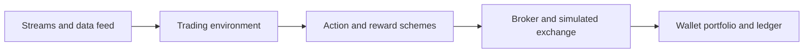
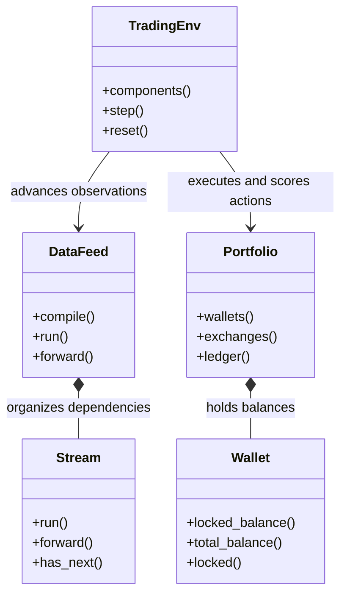
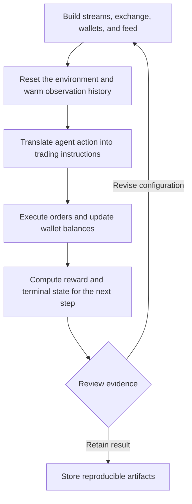
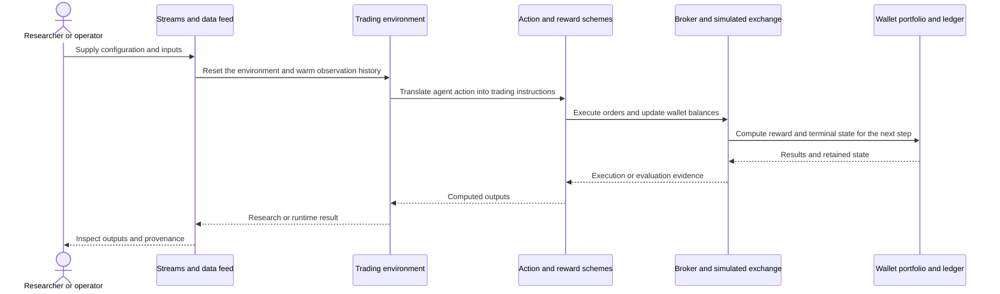
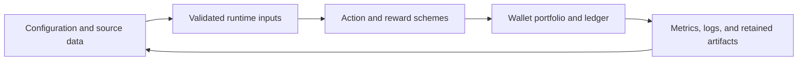
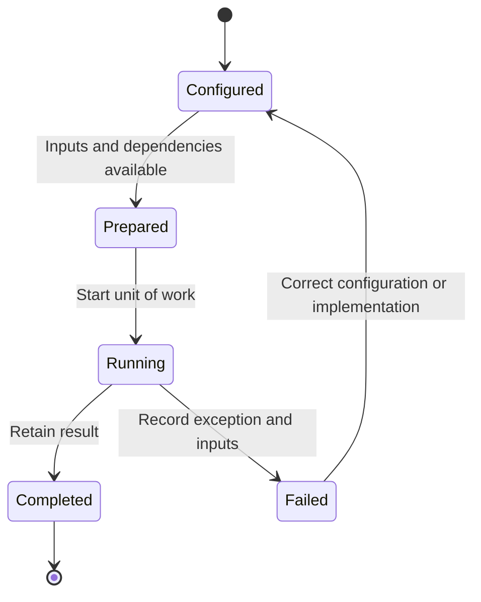

# TensorTrade: workflow and architecture

Updated 2026-10-12. Source baseline: `161164e65108a4dec792db4a7a735fadeb8549bd` on `feature/ayu_develop`. See [development commands](development.md) and [validation evidence](validation.md) for the tested environment and current limitations.

## Purpose and features

Models a trading task as a Gymnasium environment with data streams, action schemes, rewards, observations, wallets, and simulated order execution.

- Gymnasium-compatible trading environments
- Composable streams and data feeds
- Wallet and portfolio accounting
- Configurable action, observation, reward, and stop components
- Stochastic price processes and reinforcement-learning integrations

## Component architecture

Environment components separate the learning agent from execution and accounting rules. A data feed advances streams while action schemes translate a discrete or continuous choice into orders. Exchange services apply fills and wallet changes, and the reward scheme scores the resulting transition. This division makes it possible to alter the reward or observation model without silently changing portfolio accounting. Episode termination and truncation follow the Gymnasium interaction boundary.

The diagram shows responsibility boundaries in the main research or execution path. Concrete entry points and implementation files are linked below.

## Core types

The types below belong to the public or native boundary described by the linked implementation. Arrows describe the dependency or ownership relationship used in the documented workflow. Listed Python methods are present in the linked source; native array types represent the binding boundary.

## End-to-end workflow

1. Build streams, exchange, wallets, and feed.
2. Reset the environment and warm observation history.
3. Translate agent action into trading instructions.
4. Execute orders and update wallet balances.
5. Compute reward and terminal state for the next step.

## Interaction sequence

The sequence follows one unit of work. Results return across the same boundaries that accepted the configuration and data. External I/O and numerical execution have different failure modes and should retain separate evidence.

## Data and artifact lifecycle

Inputs include explicit strategy or model settings, data selection, and execution assumptions. Retaining these with outputs makes a rerun reviewable. Temporary environments and caches remain development artifacts, while source-controlled configuration documents intended behavior.

## Execution and failure boundaries

TensorFlow and stochastic numerical dependencies constrain available Python versions. Ray RLlib integration tests require its additional environment and training dependencies. Broker adapters remain external integrations. The maintenance retains all existing tests and records missing integrations rather than interpreting collection success as training validation.

This state diagram describes the documented workflow, not a claim that these names are an implementation enum. Failure evidence should identify whether input preparation, external services, native compilation, or application execution failed.

## Development layout

Python package src/tensortrade and Hatchling packaging are preserved. uv manages runtime, documentation, and test dependencies. Native TensorFlow wheels remain third-party binary requirements.

## Source map

| Existing source | Responsibility evidence |
|---|---|
| [src/tensortrade/env/generic/environment.py](../src/tensortrade/env/generic/environment.py#L35) | Implementation and module/type documentation, beginning at line 35 |
| [src/tensortrade/env/default/__init__.py](../src/tensortrade/env/default/__init__.py#L17) | Implementation and module/type documentation, beginning at line 17 |
| [src/tensortrade/env/default/actions.py](../src/tensortrade/env/default/actions.py#L24) | Implementation and module/type documentation, beginning at line 24 |
| [src/tensortrade/env/default/rewards.py](../src/tensortrade/env/default/rewards.py#L12) | Implementation and module/type documentation, beginning at line 12 |
| [src/tensortrade/env/default/observers.py](../src/tensortrade/env/default/observers.py#L19) | Implementation and module/type documentation, beginning at line 19 |
| [src/tensortrade/feed/core/feed.py](../src/tensortrade/feed/core/feed.py#L8) | Implementation and module/type documentation, beginning at line 8 |
| [src/tensortrade/feed/core/base.py](../src/tensortrade/feed/core/base.py#L24) | Implementation and module/type documentation, beginning at line 24 |
| [src/tensortrade/oms/orders/broker.py](../src/tensortrade/oms/orders/broker.py#L23) | Implementation and module/type documentation, beginning at line 23 |
| [src/tensortrade/oms/orders/order.py](../src/tensortrade/oms/orders/order.py#L28) | Implementation and module/type documentation, beginning at line 28 |
| [src/tensortrade/oms/exchanges/exchange.py](../src/tensortrade/oms/exchanges/exchange.py#L23) | Implementation and module/type documentation, beginning at line 23 |
| [src/tensortrade/oms/wallets/portfolio.py](../src/tensortrade/oms/wallets/portfolio.py#L32) | Implementation and module/type documentation, beginning at line 32 |
| [src/tensortrade/oms/wallets/wallet.py](../src/tensortrade/oms/wallets/wallet.py#L37) | Implementation and module/type documentation, beginning at line 37 |
| [src/tensortrade/oms/wallets/ledger.py](../src/tensortrade/oms/wallets/ledger.py#L21) | Implementation and module/type documentation, beginning at line 21 |

The links target files present in this checkout. Follow their imports and adjacent tests when changing a boundary. The validation document distinguishes successful builds, complete test runs, inherited skips, and unresolved prerequisites.
