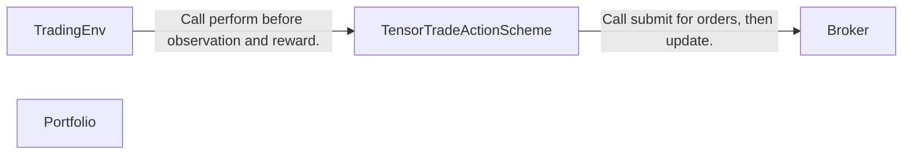
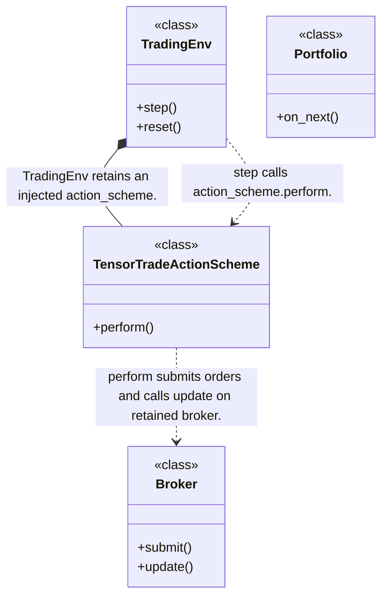
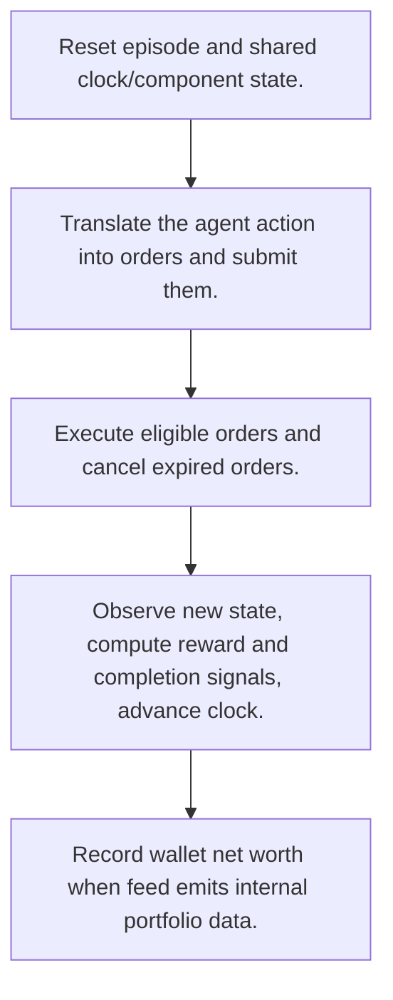
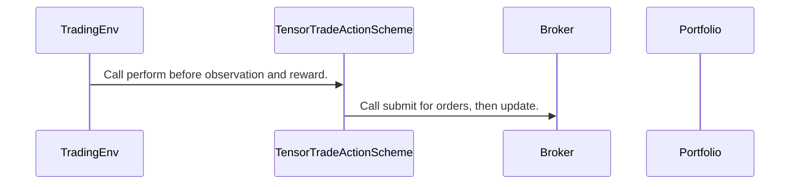

# TensorTrade: workflow, design and architecture

Updated: **2026-10-13**
Reviewed Git hash: `5adbd3f54c35c183bcf42ed230c9c7f74847b451`
Branch: `feature/ayu_develop`
Source diff SHA256: `e3b0c44298fc1c149afbf4c8996fb92427ae41e4649b934ca495991b7852b855`
Scope: **Reinforcement learning trading environment** / Maintenance: **active**
Languages: Python

[HTML edition](ayu-develop.html) / [Development](development.md) / [Historical validation](validation.md) / [Full system comparison](../../docs/index.html)

## Purpose and scope

Expose configurable Gymnasium trading episodes with actions, observations, rewards and a simulated order/portfolio system.

## Features and support boundaries

Native = implemented here. Integration = supplied through a named host/API. Limited = material restriction. Not provided = evidenced scope exclusion. Unverified = support/absence not established. Not applicable = outside this artifact type.

| Capability | Status | Implementation and limits | Source |
|---|---|---|---|
| Backtesting | Native | Trading episodes simulate historical action/order/wallet progression. | [TradingEnv.step](../src/tensortrade/env/generic/environment.py) ([L132](https://github.com/alexcwyu/tensortrade/blob/5adbd3f54c35c183bcf42ed230c9c7f74847b451/src/tensortrade/env/generic/environment.py#L132)) / [TradingEnv.reset](../src/tensortrade/env/generic/environment.py) ([L168](https://github.com/alexcwyu/tensortrade/blob/5adbd3f54c35c183bcf42ed230c9c7f74847b451/src/tensortrade/env/generic/environment.py#L168)) / [TensorTradeActionScheme.perform](../src/tensortrade/env/default/actions.py) ([L75](https://github.com/alexcwyu/tensortrade/blob/5adbd3f54c35c183bcf42ed230c9c7f74847b451/src/tensortrade/env/default/actions.py#L75)) / [Broker.submit](../src/tensortrade/oms/orders/broker.py) ([L45](https://github.com/alexcwyu/tensortrade/blob/5adbd3f54c35c183bcf42ed230c9c7f74847b451/src/tensortrade/oms/orders/broker.py#L45)) / [Broker.update](../src/tensortrade/oms/orders/broker.py) ([L73](https://github.com/alexcwyu/tensortrade/blob/5adbd3f54c35c183bcf42ed230c9c7f74847b451/src/tensortrade/oms/orders/broker.py#L73)) / [Portfolio.on_next](../src/tensortrade/oms/wallets/portfolio.py) ([L288](https://github.com/alexcwyu/tensortrade/blob/5adbd3f54c35c183bcf42ed230c9c7f74847b451/src/tensortrade/oms/wallets/portfolio.py#L288)) |
| Live execution | Unverified | CCXT, IB and Robinhood execution adapter files in this checkout are empty. They cannot substantiate a working live integration. | Not applicable to this repository scope. |
| Paper trading | Limited | Internal simulated order execution rather than a validated broker paper account. | [Broker.submit](../src/tensortrade/oms/orders/broker.py) ([L45](https://github.com/alexcwyu/tensortrade/blob/5adbd3f54c35c183bcf42ed230c9c7f74847b451/src/tensortrade/oms/orders/broker.py#L45)) / [Broker.update](../src/tensortrade/oms/orders/broker.py) ([L73](https://github.com/alexcwyu/tensortrade/blob/5adbd3f54c35c183bcf42ed230c9c7f74847b451/src/tensortrade/oms/orders/broker.py#L73)) |
| Event driven | Native | Clock-indexed actions trigger orders and portfolio observation updates. | [TradingEnv.step](../src/tensortrade/env/generic/environment.py) ([L132](https://github.com/alexcwyu/tensortrade/blob/5adbd3f54c35c183bcf42ed230c9c7f74847b451/src/tensortrade/env/generic/environment.py#L132)) / [TradingEnv.reset](../src/tensortrade/env/generic/environment.py) ([L168](https://github.com/alexcwyu/tensortrade/blob/5adbd3f54c35c183bcf42ed230c9c7f74847b451/src/tensortrade/env/generic/environment.py#L168)) / [TensorTradeActionScheme.perform](../src/tensortrade/env/default/actions.py) ([L75](https://github.com/alexcwyu/tensortrade/blob/5adbd3f54c35c183bcf42ed230c9c7f74847b451/src/tensortrade/env/default/actions.py#L75)) / [Broker.submit](../src/tensortrade/oms/orders/broker.py) ([L45](https://github.com/alexcwyu/tensortrade/blob/5adbd3f54c35c183bcf42ed230c9c7f74847b451/src/tensortrade/oms/orders/broker.py#L45)) / [Broker.update](../src/tensortrade/oms/orders/broker.py) ([L73](https://github.com/alexcwyu/tensortrade/blob/5adbd3f54c35c183bcf42ed230c9c7f74847b451/src/tensortrade/oms/orders/broker.py#L73)) |
| Vectorized | Unverified | The inspected source does not establish this capability. This is not a claim of absence. | Not applicable to this repository scope. |
| Order management | Native | Unexecuted/executed queues, executable checks and expired order cancellation. | [Broker.submit](../src/tensortrade/oms/orders/broker.py) ([L45](https://github.com/alexcwyu/tensortrade/blob/5adbd3f54c35c183bcf42ed230c9c7f74847b451/src/tensortrade/oms/orders/broker.py#L45)) / [Broker.update](../src/tensortrade/oms/orders/broker.py) ([L73](https://github.com/alexcwyu/tensortrade/blob/5adbd3f54c35c183bcf42ed230c9c7f74847b451/src/tensortrade/oms/orders/broker.py#L73)) |
| Order types | Limited | Orders execute through their service and eligibility/expiry checks. Reviewed Broker does not prove live venue order types. | [Broker.submit](../src/tensortrade/oms/orders/broker.py) ([L45](https://github.com/alexcwyu/tensortrade/blob/5adbd3f54c35c183bcf42ed230c9c7f74847b451/src/tensortrade/oms/orders/broker.py#L45)) / [Broker.update](../src/tensortrade/oms/orders/broker.py) ([L73](https://github.com/alexcwyu/tensortrade/blob/5adbd3f54c35c183bcf42ed230c9c7f74847b451/src/tensortrade/oms/orders/broker.py#L73)) |
| Multi venue | Unverified | Internal exchange/wallet abstractions do not establish operational multi-venue broker connectivity. | Not applicable to this repository scope. |
| Crypto | Unverified | The inspected source does not establish this capability. This is not a claim of absence. | Not applicable to this repository scope. |
| Equities | Unverified | The inspected source does not establish this capability. This is not a claim of absence. | Not applicable to this repository scope. |
| Futures | Unverified | The inspected source does not establish this capability. This is not a claim of absence. | Not applicable to this repository scope. |
| Options | Unverified | The inspected source does not establish this capability. This is not a claim of absence. | Not applicable to this repository scope. |
| Forex | Unverified | The inspected source does not establish this capability. This is not a claim of absence. | Not applicable to this repository scope. |
| Strategy api | Native | Replaceable action, observation, reward and termination components. | [TradingEnv.step](../src/tensortrade/env/generic/environment.py) ([L132](https://github.com/alexcwyu/tensortrade/blob/5adbd3f54c35c183bcf42ed230c9c7f74847b451/src/tensortrade/env/generic/environment.py#L132)) / [TradingEnv.reset](../src/tensortrade/env/generic/environment.py) ([L168](https://github.com/alexcwyu/tensortrade/blob/5adbd3f54c35c183bcf42ed230c9c7f74847b451/src/tensortrade/env/generic/environment.py#L168)) |
| Optimization | Unverified | The inspected source does not establish this capability. This is not a claim of absence. | Not applicable to this repository scope. |
| Machine learning | Integration | Environment can be consumed by external learning algorithms. TradingEnv itself is not a trainer. | [TradingEnv.step](../src/tensortrade/env/generic/environment.py) ([L132](https://github.com/alexcwyu/tensortrade/blob/5adbd3f54c35c183bcf42ed230c9c7f74847b451/src/tensortrade/env/generic/environment.py#L132)) / [TradingEnv.reset](../src/tensortrade/env/generic/environment.py) ([L168](https://github.com/alexcwyu/tensortrade/blob/5adbd3f54c35c183bcf42ed230c9c7f74847b451/src/tensortrade/env/generic/environment.py#L168)) |
| Reinforcement learning | Native | Gymnasium step/reset and action/observation spaces support agent training. | [TradingEnv.step](../src/tensortrade/env/generic/environment.py) ([L132](https://github.com/alexcwyu/tensortrade/blob/5adbd3f54c35c183bcf42ed230c9c7f74847b451/src/tensortrade/env/generic/environment.py#L132)) / [TradingEnv.reset](../src/tensortrade/env/generic/environment.py) ([L168](https://github.com/alexcwyu/tensortrade/blob/5adbd3f54c35c183bcf42ed230c9c7f74847b451/src/tensortrade/env/generic/environment.py#L168)) |
| Portfolio | Native | Wallet net worth and stepwise performance are recorded. | [Portfolio.on_next](../src/tensortrade/oms/wallets/portfolio.py) ([L288](https://github.com/alexcwyu/tensortrade/blob/5adbd3f54c35c183bcf42ed230c9c7f74847b451/src/tensortrade/oms/wallets/portfolio.py#L288)) |
| Risk management | Limited | Episode stopper and order expiry controls. Configured risk-order schemes are separate from the inspected default action base. | [TradingEnv.step](../src/tensortrade/env/generic/environment.py) ([L132](https://github.com/alexcwyu/tensortrade/blob/5adbd3f54c35c183bcf42ed230c9c7f74847b451/src/tensortrade/env/generic/environment.py#L132)) / [TradingEnv.reset](../src/tensortrade/env/generic/environment.py) ([L168](https://github.com/alexcwyu/tensortrade/blob/5adbd3f54c35c183bcf42ed230c9c7f74847b451/src/tensortrade/env/generic/environment.py#L168)) / [Broker.submit](../src/tensortrade/oms/orders/broker.py) ([L45](https://github.com/alexcwyu/tensortrade/blob/5adbd3f54c35c183bcf42ed230c9c7f74847b451/src/tensortrade/oms/orders/broker.py#L45)) / [Broker.update](../src/tensortrade/oms/orders/broker.py) ([L73](https://github.com/alexcwyu/tensortrade/blob/5adbd3f54c35c183bcf42ed230c9c7f74847b451/src/tensortrade/oms/orders/broker.py#L73)) |
| Performance analytics | Native | Portfolio performance listener receives current performance step. | [Portfolio.on_next](../src/tensortrade/oms/wallets/portfolio.py) ([L288](https://github.com/alexcwyu/tensortrade/blob/5adbd3f54c35c183bcf42ed230c9c7f74847b451/src/tensortrade/oms/wallets/portfolio.py#L288)) |
| Historical data | Unverified | The inspected source does not establish this capability. This is not a claim of absence. | Not applicable to this repository scope. |
| Streaming data | Unverified | The inspected source does not establish this capability. This is not a claim of absence. | Not applicable to this repository scope. |
| Persistence | Unverified | The inspected source does not establish this capability. This is not a claim of absence. | Not applicable to this repository scope. |
| Data pipeline | Unverified | The inspected source does not establish this capability. This is not a claim of absence. | Not applicable to this repository scope. |
| Web ui | Unverified | The inspected source does not establish this capability. This is not a claim of absence. | Not applicable to this repository scope. |
| Cli | Unverified | The inspected source does not establish this capability. This is not a claim of absence. | Not applicable to this repository scope. |
| Monitoring | Unverified | The inspected source does not establish this capability. This is not a claim of absence. | Not applicable to this repository scope. |
| Extension api | Native | Environment component injection and action-to-order interface. | [TradingEnv.step](../src/tensortrade/env/generic/environment.py) ([L132](https://github.com/alexcwyu/tensortrade/blob/5adbd3f54c35c183bcf42ed230c9c7f74847b451/src/tensortrade/env/generic/environment.py#L132)) / [TradingEnv.reset](../src/tensortrade/env/generic/environment.py) ([L168](https://github.com/alexcwyu/tensortrade/blob/5adbd3f54c35c183bcf42ed230c9c7f74847b451/src/tensortrade/env/generic/environment.py#L168)) / [TensorTradeActionScheme.perform](../src/tensortrade/env/default/actions.py) ([L75](https://github.com/alexcwyu/tensortrade/blob/5adbd3f54c35c183bcf42ed230c9c7f74847b451/src/tensortrade/env/default/actions.py#L75)) |
| Native acceleration | Unverified | The inspected source does not establish this capability. This is not a claim of absence. | Not applicable to this repository scope. |
| Distributed execution | Unverified | The inspected source does not establish this capability. This is not a claim of absence. | Not applicable to this repository scope. |

## System components

| Component | Responsibility | Source |
|---|---|---|
| TradingEnv | Gymnasium environment episode lifecycle. | [TradingEnv.step](../src/tensortrade/env/generic/environment.py) ([L132](https://github.com/alexcwyu/tensortrade/blob/5adbd3f54c35c183bcf42ed230c9c7f74847b451/src/tensortrade/env/generic/environment.py#L132)) / [TradingEnv.reset](../src/tensortrade/env/generic/environment.py) ([L168](https://github.com/alexcwyu/tensortrade/blob/5adbd3f54c35c183bcf42ed230c9c7f74847b451/src/tensortrade/env/generic/environment.py#L168)) |
| TensorTradeActionScheme | Agent action to order conversion. | [TensorTradeActionScheme.perform](../src/tensortrade/env/default/actions.py) ([L75](https://github.com/alexcwyu/tensortrade/blob/5adbd3f54c35c183bcf42ed230c9c7f74847b451/src/tensortrade/env/default/actions.py#L75)) |
| Broker | Internal simulated OMS and expiry lifecycle. | [Broker.submit](../src/tensortrade/oms/orders/broker.py) ([L45](https://github.com/alexcwyu/tensortrade/blob/5adbd3f54c35c183bcf42ed230c9c7f74847b451/src/tensortrade/oms/orders/broker.py#L45)) / [Broker.update](../src/tensortrade/oms/orders/broker.py) ([L73](https://github.com/alexcwyu/tensortrade/blob/5adbd3f54c35c183bcf42ed230c9c7f74847b451/src/tensortrade/oms/orders/broker.py#L73)) |
| Portfolio | Wallet portfolio performance and net worth. | [Portfolio.on_next](../src/tensortrade/oms/wallets/portfolio.py) ([L288](https://github.com/alexcwyu/tensortrade/blob/5adbd3f54c35c183bcf42ed230c9c7f74847b451/src/tensortrade/oms/wallets/portfolio.py#L288)) |

## Architecture and component boundaries

The component view summarizes inspected responsibility boundaries. Arrows identify the documented API/data dependencies; this is not a deployment-readiness claim.

- Call perform before observation and reward.: [TradingEnv.step](../src/tensortrade/env/generic/environment.py) ([L132](https://github.com/alexcwyu/tensortrade/blob/5adbd3f54c35c183bcf42ed230c9c7f74847b451/src/tensortrade/env/generic/environment.py#L132)) / [TradingEnv.reset](../src/tensortrade/env/generic/environment.py) ([L168](https://github.com/alexcwyu/tensortrade/blob/5adbd3f54c35c183bcf42ed230c9c7f74847b451/src/tensortrade/env/generic/environment.py#L168))
- Call submit for orders, then update.: [TensorTradeActionScheme.perform](../src/tensortrade/env/default/actions.py) ([L75](https://github.com/alexcwyu/tensortrade/blob/5adbd3f54c35c183bcf42ed230c9c7f74847b451/src/tensortrade/env/default/actions.py#L75))

## Design decisions

| Decision | Rationale | Tradeoff | Evidence |
|---|---|---|---|
| Separate environment actions, rewards, observations and stopping policies. | Training algorithms can use a standard Gymnasium API with custom financial components. | The modeler is responsible for environment realism and learning policy. | [TradingEnv.step](../src/tensortrade/env/generic/environment.py) ([L132](https://github.com/alexcwyu/tensortrade/blob/5adbd3f54c35c183bcf42ed230c9c7f74847b451/src/tensortrade/env/generic/environment.py#L132)) / [TradingEnv.reset](../src/tensortrade/env/generic/environment.py) ([L168](https://github.com/alexcwyu/tensortrade/blob/5adbd3f54c35c183bcf42ed230c9c7f74847b451/src/tensortrade/env/generic/environment.py#L168)) |

## Class and interface relationships

Each node is a reviewed source symbol. Function/module nodes are explicitly labeled; they do not imply Python classes. Only reviewed relationships are drawn.

- **TradingEnv** (class): [TradingEnv.step](../src/tensortrade/env/generic/environment.py) ([L132](https://github.com/alexcwyu/tensortrade/blob/5adbd3f54c35c183bcf42ed230c9c7f74847b451/src/tensortrade/env/generic/environment.py#L132)) / [TradingEnv.reset](../src/tensortrade/env/generic/environment.py) ([L168](https://github.com/alexcwyu/tensortrade/blob/5adbd3f54c35c183bcf42ed230c9c7f74847b451/src/tensortrade/env/generic/environment.py#L168))
- **TensorTradeActionScheme** (class): [TensorTradeActionScheme.perform](../src/tensortrade/env/default/actions.py) ([L75](https://github.com/alexcwyu/tensortrade/blob/5adbd3f54c35c183bcf42ed230c9c7f74847b451/src/tensortrade/env/default/actions.py#L75))
- **Broker** (class): [Broker.submit](../src/tensortrade/oms/orders/broker.py) ([L45](https://github.com/alexcwyu/tensortrade/blob/5adbd3f54c35c183bcf42ed230c9c7f74847b451/src/tensortrade/oms/orders/broker.py#L45)) / [Broker.update](../src/tensortrade/oms/orders/broker.py) ([L73](https://github.com/alexcwyu/tensortrade/blob/5adbd3f54c35c183bcf42ed230c9c7f74847b451/src/tensortrade/oms/orders/broker.py#L73))
- **Portfolio** (class): [Portfolio.on_next](../src/tensortrade/oms/wallets/portfolio.py) ([L288](https://github.com/alexcwyu/tensortrade/blob/5adbd3f54c35c183bcf42ed230c9c7f74847b451/src/tensortrade/oms/wallets/portfolio.py#L288))

## Workflow

### Representative source-backed flow

The steps describe the inspected implementation. User configuration and data inputs are external prerequisites.

1. Reset episode and shared clock/component state.. [TradingEnv.step](../src/tensortrade/env/generic/environment.py) ([L132](https://github.com/alexcwyu/tensortrade/blob/5adbd3f54c35c183bcf42ed230c9c7f74847b451/src/tensortrade/env/generic/environment.py#L132)) / [TradingEnv.reset](../src/tensortrade/env/generic/environment.py) ([L168](https://github.com/alexcwyu/tensortrade/blob/5adbd3f54c35c183bcf42ed230c9c7f74847b451/src/tensortrade/env/generic/environment.py#L168))
2. Translate the agent action into orders and submit them.. [TensorTradeActionScheme.perform](../src/tensortrade/env/default/actions.py) ([L75](https://github.com/alexcwyu/tensortrade/blob/5adbd3f54c35c183bcf42ed230c9c7f74847b451/src/tensortrade/env/default/actions.py#L75))
3. Execute eligible orders and cancel expired orders.. [Broker.submit](../src/tensortrade/oms/orders/broker.py) ([L45](https://github.com/alexcwyu/tensortrade/blob/5adbd3f54c35c183bcf42ed230c9c7f74847b451/src/tensortrade/oms/orders/broker.py#L45)) / [Broker.update](../src/tensortrade/oms/orders/broker.py) ([L73](https://github.com/alexcwyu/tensortrade/blob/5adbd3f54c35c183bcf42ed230c9c7f74847b451/src/tensortrade/oms/orders/broker.py#L73))
4. Observe new state, compute reward and completion signals, advance clock.. [TradingEnv.step](../src/tensortrade/env/generic/environment.py) ([L132](https://github.com/alexcwyu/tensortrade/blob/5adbd3f54c35c183bcf42ed230c9c7f74847b451/src/tensortrade/env/generic/environment.py#L132)) / [TradingEnv.reset](../src/tensortrade/env/generic/environment.py) ([L168](https://github.com/alexcwyu/tensortrade/blob/5adbd3f54c35c183bcf42ed230c9c7f74847b451/src/tensortrade/env/generic/environment.py#L168))
5. Record wallet net worth when feed emits internal portfolio data.. [Portfolio.on_next](../src/tensortrade/oms/wallets/portfolio.py) ([L288](https://github.com/alexcwyu/tensortrade/blob/5adbd3f54c35c183bcf42ed230c9c7f74847b451/src/tensortrade/oms/wallets/portfolio.py#L288))

## Sequence

Representative calls and data dependencies

Messages represent inspected calls or explicitly labelled data dependencies. A data dependency is not an asserted direct runtime call.

- Call perform before observation and reward.: [TradingEnv.step](../src/tensortrade/env/generic/environment.py) ([L132](https://github.com/alexcwyu/tensortrade/blob/5adbd3f54c35c183bcf42ed230c9c7f74847b451/src/tensortrade/env/generic/environment.py#L132)) / [TradingEnv.reset](../src/tensortrade/env/generic/environment.py) ([L168](https://github.com/alexcwyu/tensortrade/blob/5adbd3f54c35c183bcf42ed230c9c7f74847b451/src/tensortrade/env/generic/environment.py#L168))
- Call submit for orders, then update.: [TensorTradeActionScheme.perform](../src/tensortrade/env/default/actions.py) ([L75](https://github.com/alexcwyu/tensortrade/blob/5adbd3f54c35c183bcf42ed230c9c7f74847b451/src/tensortrade/env/default/actions.py#L75))

## Strengths and limits

### Strengths

- The step order and termination/truncation split are explicit in implementation. [TradingEnv.step](../src/tensortrade/env/generic/environment.py) ([L132](https://github.com/alexcwyu/tensortrade/blob/5adbd3f54c35c183bcf42ed230c9c7f74847b451/src/tensortrade/env/generic/environment.py#L132)) / [TradingEnv.reset](../src/tensortrade/env/generic/environment.py) ([L168](https://github.com/alexcwyu/tensortrade/blob/5adbd3f54c35c183bcf42ed230c9c7f74847b451/src/tensortrade/env/generic/environment.py#L168))

### Limitations

- External execution adapter modules ccxt.py, interactive_brokers.py and robinhood.py are zero-length in the current checkout. Not applicable to this repository scope.

## Validation scope

The linked validation and command records preserve actual historical runs and user-authorized exclusions. This source/document review does not rerun application tests, establish live trading readiness or rank benchmark performance. Current data, credential and runtime prerequisites remain material.

[Repository validation](validation.md) / [Executed checks](maintenance/index.md)

## Source map

| Reviewed symbol/path | Inspected responsibility | Actual file SHA256 |
|---|---|---|
| [TradingEnv.step](../src/tensortrade/env/generic/environment.py) ([L132](https://github.com/alexcwyu/tensortrade/blob/5adbd3f54c35c183bcf42ed230c9c7f74847b451/src/tensortrade/env/generic/environment.py#L132)) | Performs action, observes, computes reward and termination/truncation/info, increments clock, returns Gymnasium five-tuple. | `13f36372d15aed0eb1716fd5ef929ca863c63874fa7023a360e69027a31c9841` |
| [TradingEnv.reset](../src/tensortrade/env/generic/environment.py) ([L168](https://github.com/alexcwyu/tensortrade/blob/5adbd3f54c35c183bcf42ed230c9c7f74847b451/src/tensortrade/env/generic/environment.py#L168)) | Resets component state and random starting point, returns initial observation/info. | `13f36372d15aed0eb1716fd5ef929ca863c63874fa7023a360e69027a31c9841` |
| [TensorTradeActionScheme.perform](../src/tensortrade/env/default/actions.py) ([L75](https://github.com/alexcwyu/tensortrade/blob/5adbd3f54c35c183bcf42ed230c9c7f74847b451/src/tensortrade/env/default/actions.py#L75)) | Converts agent action to orders, submits each order to Broker and calls broker.update. | `f2cf8823d56e7226ebc7c2eec084cf8a29ec454bbc0112543e89f50a97e671e7` |
| [Broker.submit](../src/tensortrade/oms/orders/broker.py) ([L45](https://github.com/alexcwyu/tensortrade/blob/5adbd3f54c35c183bcf42ed230c9c7f74847b451/src/tensortrade/oms/orders/broker.py#L45)) | Queues an order as unexecuted. | `96d0a342da8587a7ede47bbc6228cf83261721173cd5869360b8e27892d92631` |
| [Broker.update](../src/tensortrade/oms/orders/broker.py) ([L73](https://github.com/alexcwyu/tensortrade/blob/5adbd3f54c35c183bcf42ed230c9c7f74847b451/src/tensortrade/oms/orders/broker.py#L73)) | Executes eligible orders, moves them into executed tracking and cancels expired active orders. | `96d0a342da8587a7ede47bbc6228cf83261721173cd5869360b8e27892d92631` |
| [Portfolio.on_next](../src/tensortrade/oms/wallets/portfolio.py) ([L288](https://github.com/alexcwyu/tensortrade/blob/5adbd3f54c35c183bcf42ed230c9c7f74847b451/src/tensortrade/oms/wallets/portfolio.py#L288)) | Extracts internal wallet data, records performance by clock step and updates current and initial net worth. | `5f2b1a87f4217329fc7c849ffa178b4830820a98f397f36e319ddf9c0eb27481` |

## Documentation provenance

Review date: 2026-10-13. Full committed source HEAD: `5adbd3f54c35c183bcf42ed230c9c7f74847b451`. Template version: 2. 4 source files were independently hashed for this guide.

[Evidence catalog](../../docs/systems-2026-10-13/catalog.json) / [Standard template](../../docs/guidelines/APP_TEMPLATE.md)

- Snapshot provenance: inventory.json full HEAD 5adbd3f54c35c183bcf42ed230c9c7f74847b451, branch feature/ayu_develop. Source was inspected in the existing checkout and no repository files were changed.
- Inspected implementation bodies and existing architecture documentation. This is a representative static source audit, not a runtime or live-service validation. Credential exclusions in current validation are policy, not evidence that a live connection succeeds.
- Inspected source files: src/tensortrade/env/generic/environment.py, src/tensortrade/env/default/actions.py, src/tensortrade/oms/orders/broker.py, src/tensortrade/oms/wallets/portfolio.py
- Also inspected src/tensortrade/oms/services/execution/{ccxt,interactive_brokers,robinhood}.py, all zero-length. Empty files have no positive source line and are recorded as coverage notes, not fabricated line citations.
